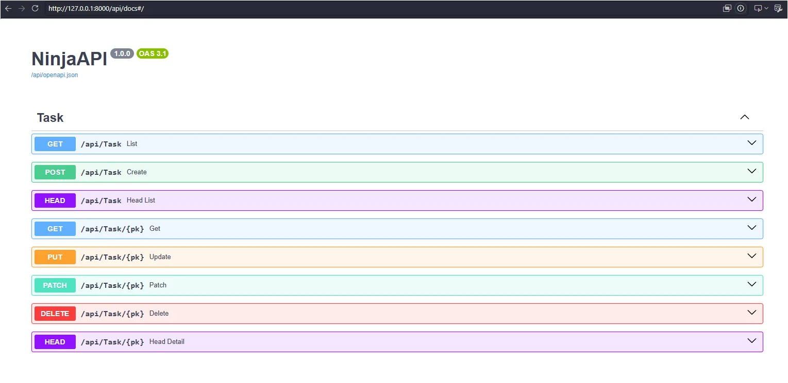

# django-ninja-expose

Add `@expose()` to a Django model. Get a REST API.

```python
from django.db import models
from django_ninja_expose import expose

@expose()
class Task(models.Model):
    title = models.CharField(max_length=200)
    completed = models.BooleanField(default=False)
```

```python
# urls.py
from django.urls import path
from ninja import NinjaAPI
from django_ninja_expose import mount

api = NinjaAPI()
mount(api)  # or api.add_router("", get_router())

urlpatterns = [path("api/", api.urls)]
```

You get `GET/POST /api/Task`, `GET/PUT/PATCH/DELETE/HEAD /api/Task/{pk}`, Django-native
filtering (`?title__icontains=x&completed=false`), Ninja pagination and OpenAPI docs.




## Usage examples

The examples below use the `Task` model above, served at `/api/Task`
(`id` is the auto-generated primary key).

### GET — list and retrieve

List objects (paginated with Ninja's default `LimitOffsetPagination`):

```http
GET /api/Task
```

```json
// 200 OK
{
  "items": [
    {"id": 1, "title": "Write docs", "completed": false},
    {"id": 2, "title": "Ship release", "completed": true}
  ],
  "count": 2
}
```

Filter with Django lookups and paginate with `limit` / `offset`:

```http
GET /api/Task?title__icontains=docs&completed=false&limit=10&offset=0
```

```json
// 200 OK
{
  "items": [{"id": 1, "title": "Write docs", "completed": false}],
  "count": 1
}
```

Retrieve a single object:

```http
GET /api/Task/1
```

```json
// 200 OK
{"id": 1, "title": "Write docs", "completed": false}
```

```json
// 404 Not Found (GET /api/Task/999)
{"detail": "Not Found"}
```

### POST — create

```http
POST /api/Task
Content-Type: application/json

{"title": "Write docs"}
```

```json
// 201 Created
{"id": 1, "title": "Write docs", "completed": false}
```

Invalid data is rejected by Django's `full_clean()`:

```http
POST /api/Task
Content-Type: application/json

{"title": ""}
```

```json
// 422 Unprocessable Entity
{
  "detail": [
    {"loc": ["body", "title"], "msg": "This field cannot be blank.", "type": "value_error"}
  ]
}
```

### PUT — full update

`PUT` replaces the object: send every writable field (fields without a default are required).

```http
PUT /api/Task/1
Content-Type: application/json

{"title": "Write better docs", "completed": true}
```

```json
// 200 OK
{"id": 1, "title": "Write better docs", "completed": true}
```

### PATCH — partial update

`PATCH` only changes the fields you send:

```http
PATCH /api/Task/1
Content-Type: application/json

{"completed": true}
```

```json
// 200 OK
{"id": 1, "title": "Write better docs", "completed": true}
```

### DELETE

```http
DELETE /api/Task/1
```

```
204 No Content
```

Deleting it again returns `404 Not Found` with `{"detail": "Not Found"}`.

### Calling the API from Python

```python
import requests

base = "http://localhost:8000/api/Task"

task = requests.post(base, json={"title": "Write docs"}).json()
requests.patch(f"{base}/{task['id']}", json={"completed": True})
print(requests.get(base, params={"completed": "true"}).json())
requests.delete(f"{base}/{task['id']}")
```

## `@expose(path=None, methods=None, fields=None, query=None, auth=INHERIT, queryset=None)`

`None` = automatic, `[]` = none, list = explicit restriction.

| arg         | `None`                            | `[]`             | list                              |
| ----------- | ----------------------------------- | ------------------ | --------------------------------- |
| `path`    | class name                          | n/a                | URL path                          |
| `methods` | all six (`HEAD` is never implied) | no operations      | only these                        |
| `fields`  | all concrete fields + M2M           | no fields          | only these                        |
| `query`   | all exposed fields                  | filtering disabled | only these (subset of `fields`) |

`auth` and `queryset` are separate: see [Authentication](#authentication) and
[Object-level authorization](#object-level-authorization).

Invalid configuration fails at import time (`ExposeConfigurationError` and subclasses);
duplicate paths fail when the router is built.

## Authentication

This library does not implement authentication. `auth` is passed straight to
django-ninja, so you can use Ninja's built-in auth, Django's session auth, or your
own.

| `auth` value            | behaviour                                                             |
| ------------------------- | --------------------------------------------------------------------- |
| `INHERIT` (default)     | use the auth of the `NinjaAPI` (or router) it is mounted on         |
| `None`                  | no authentication for this model, even if the API requires it         |
| an auth object / callable | use this auth for this model (e.g. `django_auth`, `HttpBearer()`) |
| a list                    | any one of them may authenticate (same as Ninja)                      |

```python
from ninja import NinjaAPI
from ninja.security import django_auth, HttpBearer
from django_ninja_expose import INHERIT, expose, mount

class Bearer(HttpBearer):
    def authenticate(self, request, token):
        if token == "secret":
            return token

@expose()                      # INHERIT: protected by the API-level auth below
class Task(models.Model): ...

@expose(auth=None)             # public, even though the API requires auth
class Tag(models.Model): ...

@expose(auth=Bearer())         # its own auth, overrides the API-level auth
class Invoice(models.Model): ...

@expose(auth=lambda request: request.user.is_staff or None)  # plain callable
class Report(models.Model): ...

api = NinjaAPI(auth=django_auth)
mount(api)
```

An unauthenticated request to a protected endpoint returns `401 Unauthorized`.
An invalid `auth` value raises `InvalidAuthError` at import time.

## Object-level authorization

`auth` answers "who are you?". To decide *which objects* that user may touch, pass
`queryset`, a callable `(request, qs) -> qs`:

```python
from ninja.security import django_auth

def own_documents(request, qs):
    return qs.filter(owner=request.user)

@expose(auth=django_auth, queryset=own_documents)
class Document(models.Model):
    owner = models.ForeignKey(settings.AUTH_USER_MODEL, on_delete=models.CASCADE)
    ...
```

The scoped queryset is the starting point of every operation, so:

- list, filtering and pagination only see the user's rows;
- get / put / patch / delete / head on someone else's object returns `404` (their
  existence is not leaked);
- `POST` cannot be pre-filtered, so a created row that falls outside the scope is
  rolled back and rejected with `403` (e.g. creating a Document owned by another user).

Notes: `request.user` is only set if your `auth` sets it (`django_auth` does). If you
do not want clients to choose the owner, leave it out of `fields`... but then it must
be set some other way (e.g. a model default). `PUT`/`PATCH` may still move an object
out of scope (e.g. change `owner`); exclude such fields from `fields` if that matters.
A non-callable `queryset` raises `InvalidQuerysetError` at import time.

## Security warning

`@expose()` exposes model data and CRUD operations by default. With `auth=INHERIT` it
is only protected if your `NinjaAPI` (or router) has auth, so set `NinjaAPI(auth=...)`.
Also restrict `methods`, `fields` and `query` for production APIs.

## Notes

- Foreign keys and many-to-many fields are represented by primary keys (no nesting).
- Filters accept Django lookups/transforms on whitelisted fields only; relationship traversal is rejected (HTTP 400).
- Writes run Django's `full_clean()`; non-editable fields (e.g. `auto_now_add`) are never writable.
